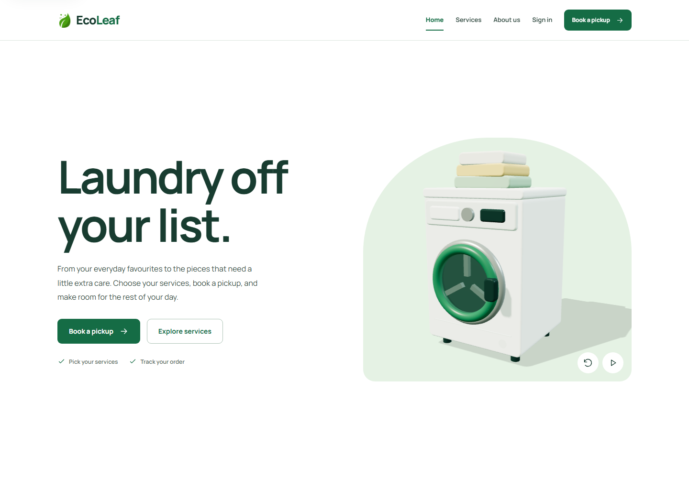
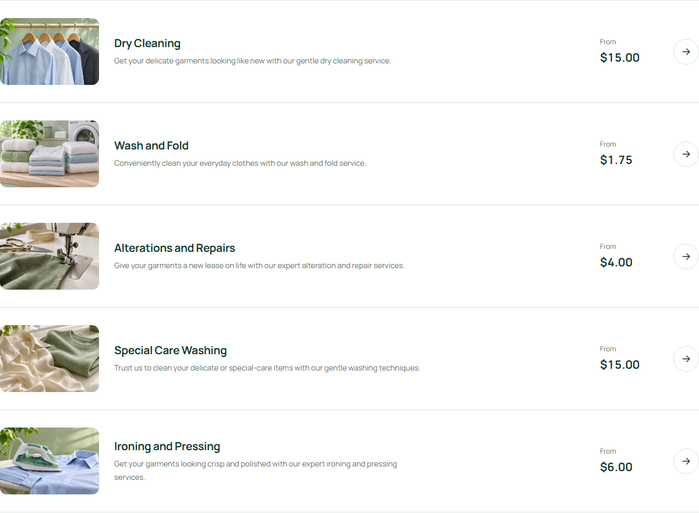
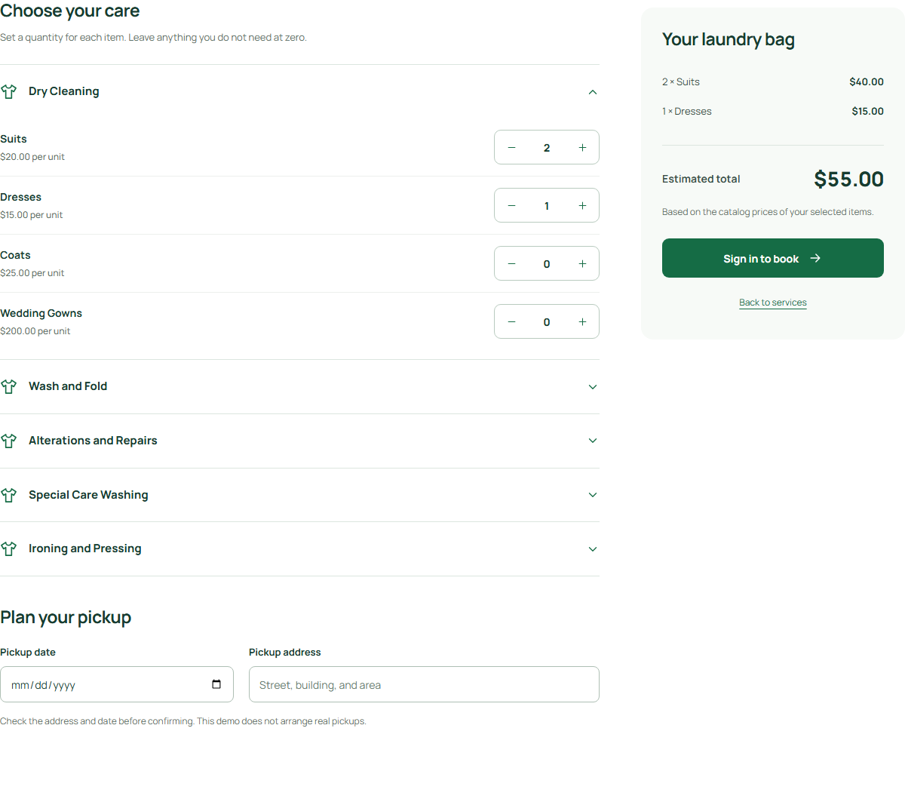
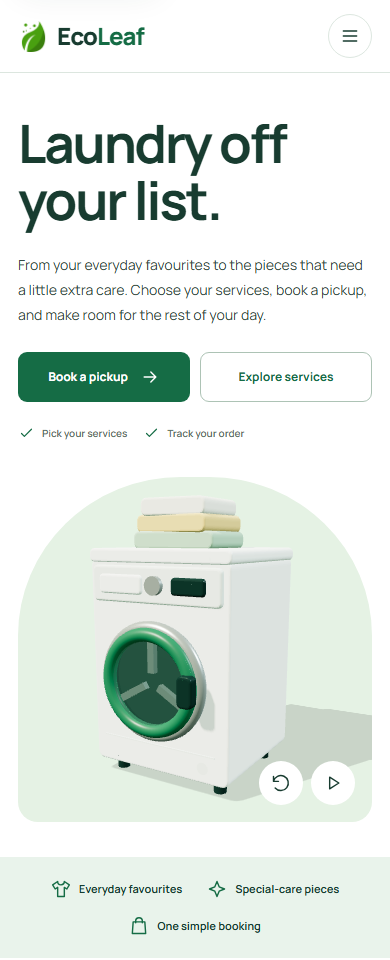

# EcoLeaf

A PHP and MySQL application for laundry service booking and order management. EcoLeaf brings service selection, pickup scheduling, customer accounts, and administration into one responsive interface.

**[Live demo](https://ecoleaf.wuaze.com/)** | [Quick start](#quick-start) | [Architecture](#architecture) | [Deployment](#deployment)

## Screenshots

Screenshots show the current development build. Click an image to view it at full resolution.

[](docs/screenshots/home.png)

<table>
  <tr>
    <th>Services and pricing</th>
    <th>Booking and pickup</th>
  </tr>
  <tr>
    <td><a href="docs/screenshots/services.png"></a></td>
    <td><a href="docs/screenshots/booking.png"></a></td>
  </tr>
</table>

<details>
<summary>View the mobile interface</summary>

<a href="docs/screenshots/mobile.png"></a>

</details>

## Features

### Customer experience

- Browse laundry services, item options, and prices.
- Select quantities and review a running booking total.
- Schedule a pickup with a date and address.
- Track order details and status, or cancel a scheduled booking.
- Manage profile information and account credentials.
- Submit ratings and reviews after a completed order.

### Administrator workspace

- View booking activity and process orders through defined status transitions.
- Search customer records and browse paginated results.
- Create services and update catalog and option prices.
- Preserve the recorded prices of existing orders when the catalog changes.
- Create additional administrators with password confirmation.

### Interface and accessibility

- Responsive layouts for desktop, tablet, and mobile screens.
- Shared navigation, visible keyboard focus, and labeled form controls.
- Inline validation, loading feedback, and useful empty states.
- Interactive 3D scene with pause and rotation controls, reduced-motion support, and a static fallback.
- Locally hosted fonts, imagery, and frontend dependencies.

## Technology stack

| Component | Technology |
| --- | --- |
| Application | PHP with MySQLi and mysqlnd |
| Database | MySQL-compatible relational database |
| Frontend | HTML, CSS, and vanilla JavaScript |
| 3D rendering | Three.js 0.169.0 |
| Local runtime | PHP 8.4, Apache, and MariaDB 11.4 through Docker Compose |
| Testing | Python, Playwright, and axe |
| Hosting | InfinityFree |

Node.js and Python are used for development and testing. The deployed application runs on PHP hosting without a Node.js server.

## Quick start

### Prerequisites

- Git
- Docker Desktop with Linux containers and Docker Compose enabled
- Python 3.10+ and Node.js 22+ to run the test suite

```bash
git clone https://github.com/Osiosi44/EcoLeaf-last-version.git
cd EcoLeaf-last-version
docker compose up -d --build
```

Open **[http://localhost:8080](http://localhost:8080)**.

The first startup initializes an empty database from `database/init.sql`, including the service catalog and options. Register through the application to create a customer account. Customer and administrator accounts are not seeded.

Database records persist in a Docker volume. Initialization runs only when that volume is empty; editing the SQL file does not update an existing database. Existing installations must apply `database/migrations/20261118_security.sql` before using the upgraded application.

```bash
# Stop the application without removing its data
docker compose stop

# Restart the application
docker compose up -d

# Inspect recent application and database logs
docker compose logs --tail=100 web database
```

The web service is bound to `127.0.0.1:8080`. The database is available within the Compose network and has no published host port. Credentials in `compose.yaml` are development defaults.

<details>
<summary>Create a local administrator</summary>

Set `ADMIN_USERNAME`, `ADMIN_EMAIL`, and `ADMIN_PASSWORD` in the current shell environment. Use a unique password of at least 12 characters, then run:

```bash
docker compose exec -e ADMIN_USERNAME -e ADMIN_EMAIL -e ADMIN_PASSWORD web php scripts/create-admin.php
```

Clear the password environment variable afterward. Further administrators can be created from the protected administrator workspace.

</details>

## Configuration

For shared hosting, copy `db/config.example.php` to `db/config.local.php` and enter the database details provided by the host. Local configuration overrides environment variables. The file is excluded from version control and deployment packages.

The standard Docker setup supplies database settings through environment variables and does not require a local configuration file.

| Variable | Description | Default |
| --- | --- | --- |
| `DB_HOST` | Database hostname | `localhost` |
| `DB_NAME` | Database name | `ecoleaf` |
| `DB_USER` | Database username | `ecoleaf` |
| `DB_PASSWORD` | Database password | Empty |
| `DB_PORT` | Database port | `3306` |
| `APP_TIMEZONE` | Booking-date timezone | `Africa/Addis_Ababa` |
| `SESSION_SECURE` | Set to `1` behind a trusted HTTPS-terminating proxy | Unset |

## Architecture

```text
EcoLeaf/
|-- admin/                    # Administrator pages and action handlers
|-- assets/                   # Fonts, photographs, and 3D assets
|-- components/layout.php     # Shared layout and interface helpers
|-- database/
|   |-- init.sql              # Fresh-install schema and service catalog
|   `-- migrations/           # Non-destructive database upgrades
|-- db/
|   |-- app.php               # Authentication, validation, and request helpers
|   `-- profile/              # Profile data and update handlers
|-- docs/                     # Deployment notes, audit, and screenshots
|-- scripts/                  # Packaging and administrator setup
|-- tests/                    # Integration and browser regression checks
|-- booking.php              # Service selection and pickup form
|-- process_order.php        # Booking validation, pricing, and persistence
|-- my_orders.php            # Customer order history and reviews
|-- profile.php              # Account management
`-- compose.yaml             # Local application and database services
```

PHP renders pages and shared components. Form handlers validate requests and persist changes through prepared statements. The booking interface updates its summary in the browser; the server independently calculates the final price from the catalog and saves the order and line items in a transaction. Repeated submissions with the same booking token return the original receipt.

Business data is stored in `users`, `services`, `service_options`, `orders`, `order_items`, and `reviews`. The `security_limits` table stores request counters and coordinates account writes.

### Security and data handling

- Session-bound CSRF tokens protect state-changing requests.
- Passwords are hashed; email and password changes require the current password.
- Administrator permissions are checked against the current database record.
- Output escaping and a Content Security Policy protect rendered pages.
- Request limits apply to authentication and other sensitive actions.
- Account deletion requires password confirmation and affects only the signed-in account.
- Sessions expire after 30 minutes of inactivity.

## Testing

Install the development dependencies and browser:

```bash
npm ci
npx playwright install chromium
```

With the Compose services running and the web image built:

```bash
# Integration checks and authenticated browser checks
python tests/integration.py

# Public interface, responsive layout, and accessibility checks
npm run test:browser
```

Integration tests use a disposable database and a temporary web container on port `8081`, then remove both. The existing application database is not reset. Set `ECOLEAF_TEST_PORT` to use another port. Authenticated browser checks run when the Node.js development dependencies are installed.

Coverage includes registration, login, authorization, account ownership, CSRF protection, Unicode validation, concurrent registration, decimal pricing, repeated submissions, order transitions, reviews, and request throttling. Browser checks cover widths of 1440, 768, 390, and 320 pixels, including a complete mobile booking, navigation controls, reduced motion, and the rendering fallback.

Reports and test captures are written to `artifacts/qa/`. Selected documentation screenshots are stored in `docs/screenshots/`. Automated checks use Chromium and do not replace physical-device or assistive-technology testing.

## Deployment

The live demo is hosted at **[ecoleaf.wuaze.com](https://ecoleaf.wuaze.com/)**. Hosting requires PHP 8.1+ with MySQLi/mysqlnd, a MySQL-compatible database, and Apache-compatible `.htaccess` support.

Build the deployment package on Windows:

```powershell
powershell -NoProfile -ExecutionPolicy Bypass -File scripts/package-hosting.ps1
```

| Output | Purpose |
| --- | --- |
| `artifacts/ecoleaf-hosting.zip` | Application files, active assets, and dependency licenses |
| `artifacts/ecoleaf-upgrade.sql` | Migration for an existing database |
| `artifacts/ecoleaf-database.sql` | Schema and seed data for a new, empty database |
| `artifacts/DEPLOYMENT.md` | Upload, verification, and rollback instructions |

For an existing deployment, back up the files and database, import the upgrade SQL, and upload the extracted application files into `htdocs`. Preserve the hosted `db/config.local.php`. Do not import the fresh-install SQL into an existing database.

See [deployment instructions](docs/DEPLOYMENT.md) for the complete procedure and [the technical audit](docs/AUDIT.md) for implementation findings and verification limits.

## Demo scope

The demonstration supports account, booking, and order-management workflows. It does not process payments, send email, or arrange real pickups. Use test contact and address details when exploring the site.
